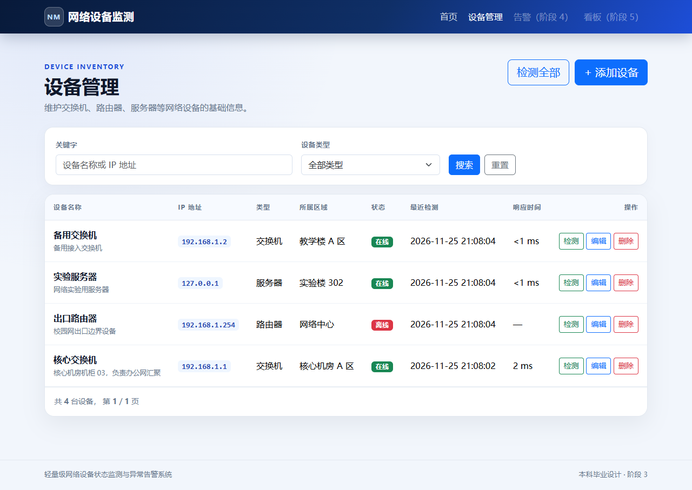

# 轻量级网络设备状态监测与异常告警系统

> 本科毕业设计项目  
> 当前进度：**阶段 3（网络状态监测）已完成**

## 1. 项目简介

本系统面向校园网、小型局域网或实验网络环境，用于维护网络设备信息、定时检测设备连通性、
记录监测历史，并对离线、响应超时等异常生成告警记录。

系统不是网络入侵检测系统，也不引入复杂的 AI 流量分析模型。核心目标是：
**设备状态可见、异常可发现、历史可追溯、告警可解释。**

## 2. 当前已实现功能

### 阶段 1：基础框架

- Spring Boot 项目骨架和分层包结构
- Maven 构建和可执行 jar 打包
- MySQL 数据库连接（HikariCP + Hibernate）
- Thymeleaf 首页
- `GET /api/health` 健康检查接口

### 阶段 2：设备管理

- `network_device` 设备表，显式 SQL 建表，JPA 使用 `validate`
- 设备新增、修改、删除、列表、详情
- IPv4 格式校验、重复 IP 校验
- 按名称/IP 关键字搜索、按类型筛选、分页
- 设备管理页面和 REST API

### 阶段 3：网络状态监测

- `monitor_record` 监测记录表
- 调用系统 `ping.exe` 做 ICMP 连通性检测
- 解析响应时间，兼容 `<1ms`、`2ms` 和中文“时间”输出
- 区分 `ONLINE`、`OFFLINE`、`ERROR`
- 手动检测单台设备
- 手动检测全部设备
- 每 60 秒自动检测（启动后延迟 15 秒）
- 更新设备最近检测时间、响应时间和状态
- 保存每次检测历史
- 设备列表显示状态、最近检测时间、响应时间
- 设备详情显示最近一次结果和最近 10 条历史
- 监测历史 REST API

当前阶段实际验证结果：

- Maven 构建：`BUILD SUCCESS`，36 个源文件
- 单体在线检测：`127.0.0.1` 返回 `ONLINE`，响应时间 `<1 ms`
- 离线检测：`192.0.2.1` 返回 `OFFLINE`，原因为请求超时
- 检测全部：4 台演示设备，在线 3 台、离线 1 台、异常 0 台
- 响应时间实际写入：1ms、2ms、0ms（表示小于 1ms）
- 定时任务实际执行：日志出现 `MonitorScheduler`，记录数持续增加
- 页面和 API 均能显示/查询监测历史



## 3. 技术栈

| 层次 | 技术 | 版本 |
|---|---|---|
| JDK | Microsoft OpenJDK 21 LTS | 21.0.13.1 |
| 后端框架 | Spring Boot | 4.1.3 |
| Web 容器 | Apache Tomcat | 11.0.27 |
| ORM | Spring Data JPA / Hibernate | 7.4.15.Final |
| 参数校验 | Jakarta Validation / Hibernate Validator | 由 Spring Boot 管理 |
| 构建工具 | Maven | 3.10.2 |
| 数据库 | MySQL Community Server | 8.4.13 LTS |
| 数据库连接池 | HikariCP | 由 Spring Boot 管理 |
| 模板引擎 | Thymeleaf | 由 Spring Boot 管理 |
| 前端框架 | Bootstrap | 5.3.9（本地静态文件） |
| 网络探测 | 操作系统 `ping.exe` | Windows 自带 |
| 前端 | HTML5 / CSS3 / 原生 JavaScript | 不引入 Node.js |
| IDE | VS Code + Java/Spring 扩展 | 1.97.2 |
| 版本控制 | Git（PortableGit） | 2.56.1 |

技术说明：

- Spring Boot 4 中 `spring-boot-starter-web` 已弃用，本项目使用
  `spring-boot-starter-webmvc`。
- Spring Boot 4.1 默认使用 Jackson 3，时间字段以 ISO-8601 字符串输出。
- 本阶段使用系统 `ping.exe`，避免 Java 原生 ICMP 在 Windows 下需要管理员权限。
- Bootstrap 文件保存在 `static/vendor/bootstrap/`，运行时不依赖 CDN。

## 4. 快速启动

### 4.1 前置条件

1. MySQL 服务 `MySQL84` 正在运行。
2. 当前 Windows 用户环境变量 `DB_PASSWORD` 已设置。
3. 8080 端口空闲。

检查命令（新开 PowerShell）：

```powershell
Get-Service MySQL84
if ($env:DB_PASSWORD) { "DB_PASSWORD 已设置" } else { "DB_PASSWORD 未设置" }
```

如果 `DB_PASSWORD` 未设置，请重新打开终端或重启 VS Code。密码文件位于项目外的
`D:\dev\secrets\mysql-netmon.txt`，不要把密码写入项目。

### 4.2 构建

```powershell
cd C:\Users\laijdsh\Documents\deepseek-harness\default-workspace\network-monitor-system
mvn clean package
```

构建前如果应用正在运行，先在运行窗口按 `Ctrl + C` 停止。

### 4.3 启动

```powershell
mvn spring-boot:run
```

或者：

```powershell
java -jar target/network-monitor-system.jar
```

启动成功后访问：

- 首页：<http://127.0.0.1:8080/>
- 设备管理：<http://127.0.0.1:8080/devices>
- 健康检查：<http://127.0.0.1:8080/api/health>
- 设备 API：<http://127.0.0.1:8080/api/devices>

停止时在运行窗口按 `Ctrl + C`。如果 8080 已被旧实例占用：

```powershell
$pid8080 = (Get-NetTCPConnection -State Listen -LocalPort 8080).OwningProcess
Stop-Process -Id $pid8080
```

## 5. 监测配置

`application.properties` 中的监测参数：

| 配置 | 默认值 | 说明 |
|---|---|---|
| `monitor.timeout-ms` | `2000` | 单次 Ping 超时时间（毫秒） |
| `monitor.interval-ms` | `60000` | 定时检测间隔（60 秒） |
| `monitor.initial-delay-ms` | `15000` | 启动后延迟 15 秒开始第一次自动检测 |
| `monitor.scheduler.enabled` | `true` | 是否启用定时检测 |

如果只想手动检测，可启动时关闭定时任务：

```powershell
java -jar target/network-monitor-system.jar --monitor.scheduler.enabled=false
```

### 在线/离线判断说明

- `ONLINE`：收到 ICMP 回复，能解析到响应时间或至少确认收到回复。
- `OFFLINE`：没有收到 ICMP 回复，例如请求超时或目标不可达。
- `ERROR`：Ping 命令无法执行、本机网络接口发送失败、目标主机无法解析等程序/本机异常。

`OFFLINE` 不等于“设备一定损坏”：防火墙可能屏蔽 ICMP，网络路径也可能临时不通。
连续失败次数、离线告警和告警去重将在阶段 4 实现。

## 6. 数据库配置

- 数据库名：`network_monitor`
- 应用账号：`netmon`（只拥有 `network_monitor` 库权限）
- 应用密码：通过环境变量 `DB_PASSWORD` 注入，不写入仓库
- 初始化脚本：`sql/init.sql`
- 阶段 2→3 迁移脚本：`sql/phase3-migration.sql`
- MySQL 服务名：`MySQL84`
- 监听地址：`127.0.0.1:3306`（仅本机）
- 字符集：`utf8mb4`
- JPA 建表策略：`validate`（表结构由 SQL 显式维护）

当前表：

- `network_device`：设备基础资料 + 最近一次监测摘要
- `monitor_record`：每次 Ping 检测的历史记录

详细字段、索引和约束见 [docs/数据库设计.md](docs/数据库设计.md)。

## 7. 目录结构（阶段 3 关键文件）

```text
network-monitor-system/
├── src/main/java/com/networkmonitor/
│   ├── controller/
│   │   ├── DeviceController.java          # 设备页面
│   │   ├── MonitorController.java         # 检测按钮/检测全部
│   │   └── api/
│   │       ├── DeviceApiController.java   # 设备 REST API
│   │       ├── MonitorApiController.java  # 检测/历史 REST API
│   │       └── ApiExceptionHandler.java
│   ├── dto/
│   │   ├── MonitorRecordResponse.java
│   │   └── CheckAllResponse.java
│   ├── entity/
│   │   ├── NetworkDevice.java
│   │   └── MonitorRecord.java
│   ├── monitor/
│   │   ├── PingMonitor.java               # 调用 ping.exe 并解析
│   │   └── PingResult.java
│   ├── repository/
│   │   └── MonitorRecordRepository.java
│   ├── scheduler/
│   │   └── MonitorScheduler.java          # 60 秒定时检测
│   └── service/
│       └── MonitorService.java            # 检测 + 保存历史 + 更新摘要
├── src/main/resources/
│   ├── templates/devices/list.html        # 状态/最近检测/响应时间
│   ├── templates/devices/detail.html      # 最近检测 + 历史表
│   └── application.properties            # monitor.* 参数
├── sql/init.sql
├── sql/phase3-migration.sql
└── screenshots/11~15-phase3-*.png
```

## 8. 接口

| 方法 | 路径 | 说明 |
|---|---|---|
| GET | `/` | 首页 |
| GET | `/devices` | 设备列表、搜索、分页 |
| GET | `/devices/{id}` | 设备详情和监测历史 |
| POST | `/devices/{id}/check` | 手动检测单台设备 |
| POST | `/devices/check-all` | 手动检测全部设备 |
| POST | `/devices/save` | 保存设备 |
| POST | `/devices/{id}/delete` | 删除设备 |
| GET | `/api/health` | 健康检查 |
| GET | `/api/devices` | 设备分页查询 |
| GET | `/api/devices/{id}` | 查询单台设备 |
| POST | `/api/devices` | 新增设备 |
| PUT | `/api/devices/{id}` | 修改设备 |
| DELETE | `/api/devices/{id}` | 删除设备 |
| POST | `/api/devices/{id}/check` | 检测单台设备 |
| POST | `/api/devices/check-all` | 检测全部设备 |
| GET | `/api/devices/{id}/records` | 分页查询监测历史 |
| GET | `/api/devices/{id}/records/latest` | 最近一条监测记录 |

监测记录示例：

```json
{
  "id": 6,
  "deviceId": 3,
  "deviceName": "实验服务器",
  "checkTime": "2026-11-25T21:05:28.072208",
  "reachable": true,
  "responseTimeMs": 0,
  "status": "ONLINE",
  "resultMessage": "收到 ICMP 回复，响应时间小于 1 ms"
}
```

详细说明见 [docs/接口说明.md](docs/接口说明.md)。

## 9. 安全与使用边界

- 数据库密码不写入代码、配置文件或 Git，使用环境变量注入。
- MySQL 只监听 `127.0.0.1`，不暴露到局域网。
- 仅对本人拥有或明确获得授权的设备和 IP 执行 Ping。
- 不对公网或未授权网络做扫描。
- 当前演示数据中的 `192.168.1.x` 只是设备记录标签，实际响应来自当前局域网，
  不能据此认定设备型号或归属。
- 后续 SNMP 社区字符串同样不能提交到仓库。

## 10. 文档

- [环境配置说明](docs/环境配置说明.md)
- [数据库设计](docs/数据库设计.md)
- [接口说明](docs/接口说明.md)
- [测试记录](docs/测试记录.md)
- [开发进度记录](docs/开发进度记录.md)

## 11. 后续阶段

| 阶段 | 内容 | 状态 |
|---|---|---|
| 阶段 1 | 基础框架与健康检查 | 已完成 |
| 阶段 2 | 设备管理、IP 校验、搜索分页 | 已完成 |
| 阶段 3 | Ping 检测、响应时间、手动/定时监测、历史记录 | 已完成 |
| 阶段 4 | 连续失败判断、延迟阈值、告警生成与恢复、告警去重 | 待开发 |
| 阶段 5 | ECharts 数据看板和历史趋势 | 待开发 |
| 阶段 6 | SNMP v2c 扩展 | 待开发 |
| 阶段 7 | 系统测试、异常测试、性能测试和修复 | 待开发 |
| 阶段 8 | 论文材料整理 | 待开发 |

## 12. Git 状态与远程备份

- 本地 Git 仓库已初始化，分支 `main`。
- 全局身份已配置：
  - `user.name = laijdsh`
  - `user.email = 1327933420@qq.com`
- 本地提交：
  - `b9f6959`：阶段 1-3 代码、SQL、文档、截图
  - `b5bbb0e`：Git 状态文档
- 远程仓库：
  - <https://github.com/laijdsh/harness>
  - SSH 地址：`git@github.com:laijdsh/harness.git`
- 已通过 SSH 认证，`main` 已推送并设置上游 `origin/main`。
- 工作区干净。

后续阶段 4 实现告警时，不要把 SNMP 社区字符串或数据库密码写入仓库。
