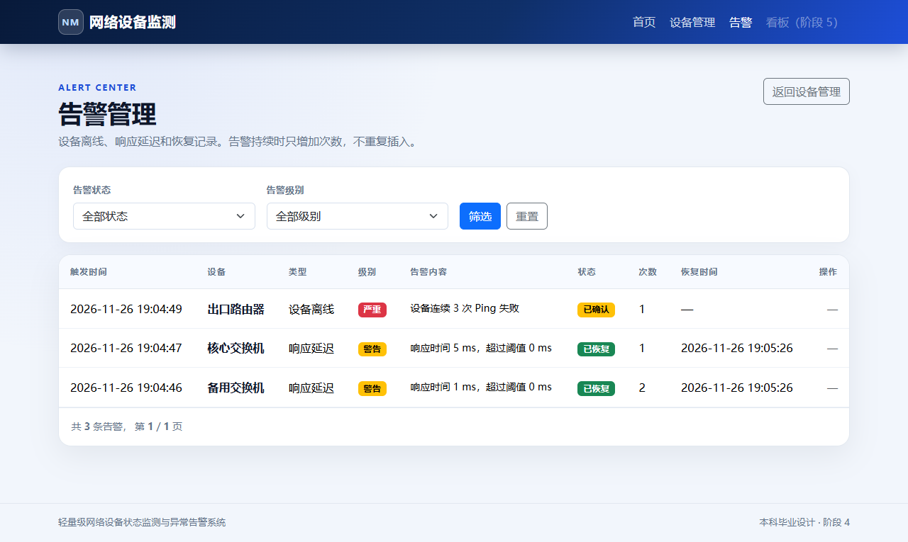
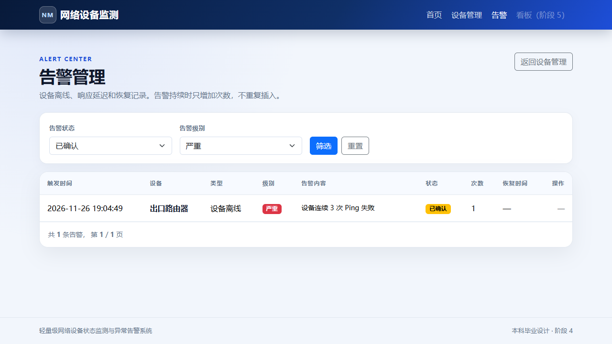
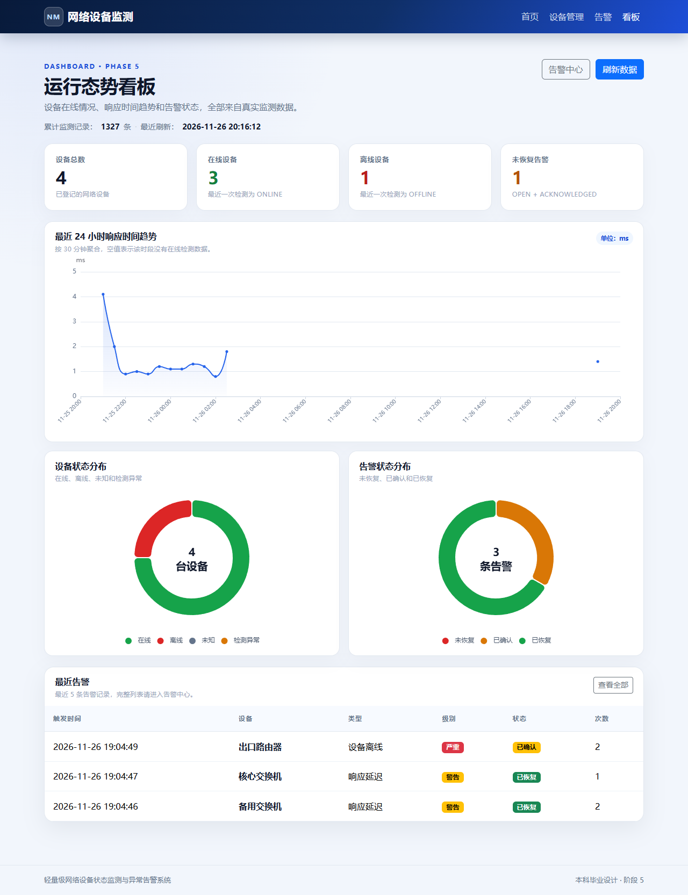
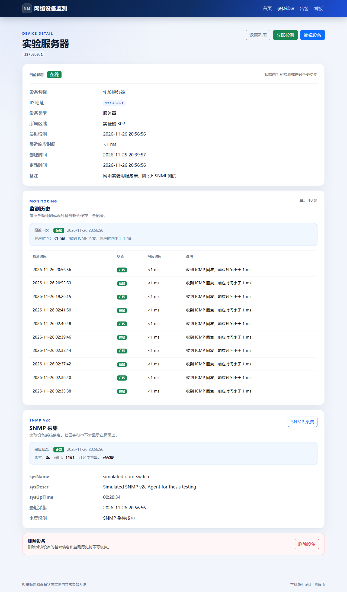
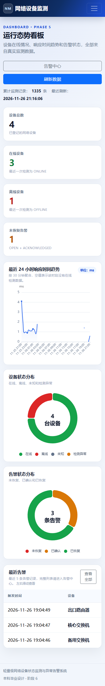

# 轻量级网络设备状态监测与异常告警系统

> 本科毕业设计项目  
> 当前进度：**阶段 7（系统测试与修复）已完成**

## 1. 项目简介

本系统面向校园网、小型局域网或实验网络环境，用于维护网络设备信息、定时检测设备连通性、
记录监测历史，并对离线、响应超时等异常生成告警记录。

系统不是网络入侵检测系统，也不引入复杂的 AI 流量分析模型。核心目标是：
**设备状态可见、异常可发现、历史可追溯、告警可解释。**

## 2. 当前已实现功能

### 阶段 1：基础框架

- Spring Boot 项目骨架和分层包结构
- Maven 构建和可执行 jar 打包
- MySQL 数据库连接（HikariCP + Hibernate）
- Thymeleaf 首页
- `GET /api/health` 健康检查接口

### 阶段 2：设备管理

- `network_device` 设备表，显式 SQL 建表，JPA 使用 `validate`
- 设备新增、修改、删除、列表、详情
- IPv4 格式校验、重复 IP 校验
- 按名称/IP 关键字搜索、按类型筛选、分页
- 设备管理页面和 REST API

### 阶段 3：网络状态监测

- `monitor_record` 监测记录表
- 调用系统 `ping.exe` 做 ICMP 连通性检测
- 解析响应时间，兼容 `<1ms`、`2ms` 和中文“时间”输出
- 区分 `ONLINE`、`OFFLINE`、`ERROR`
- 手动检测单台设备
- 手动检测全部设备
- 每 60 秒自动检测（启动后延迟 15 秒）
- 更新设备最近检测时间、响应时间和状态
- 保存每次检测历史
- 设备列表显示状态、最近检测时间、响应时间
- 设备详情显示最近一次结果和最近 10 条历史
- 监测历史 REST API

### 阶段 4：异常检测与告警

- `alert_record` 告警记录表
- 连续 3 次 `OFFLINE` 触发 `CRITICAL` 离线告警
- 在线设备响应时间超过 100ms 触发 `WARNING` 延迟告警
- 同一设备同一类型只保留一个活动告警
- 持续异常只更新 `last_seen_at` 和 `occurrence_count`
- 告警确认：`OPEN` → `ACKNOWLEDGED`
- 告警恢复：`OPEN/ACKNOWLEDGED` → `RECOVERED`
- 告警中心页面，支持状态/级别筛选
- 告警 REST API 和确认接口
- 监测检测完成后自动执行告警判断

当前阶段实际验证结果：

- Maven 构建：`BUILD SUCCESS`，47 个源文件
- 连续失败告警：第 1、2 次离线无告警；第 3 次生成 `CRITICAL` 告警
- 重复抑制：第 4 次离线仍只有 1 条告警，`occurrence_count` 从 1 增至 2
- 告警确认：接口和页面均能把状态改为 `ACKNOWLEDGED`
- 离线恢复：设备 IP 改为可达地址后，告警变为 `RECOVERED`
- 延迟告警：阈值临时设为 0ms 时，1ms/5ms 响应生成 `WARNING`
- 延迟恢复：恢复默认 100ms 后，检测在线设备，延迟告警自动 `RECOVERED`
- 删除设备：关联告警通过外键级联删除
- 告警列表：共 3 条测试告警，筛选“已确认 + 严重”返回 1 条
- 页面：告警列表、筛选、确认操作正常
- 浏览器控制台：0 error / 0 warning





### 阶段 5：ECharts 数据看板

- 新增 `/dashboard` 运行态势看板
- 汇总设备总数、在线、离线、未恢复告警和监测记录数
- 最近 24 小时平均响应时间趋势
- 设备状态分布环图
- 告警状态分布环图
- 最近 5 条告警列表
- ECharts 5.6.0 文件放在 `static/vendor/echarts/`，运行时不依赖 CDN
- 不新增数据库表，直接聚合已有数据

当前阶段实际验证结果：

- Maven 构建：`BUILD SUCCESS`，53 个源文件
- 看板汇总：4 台设备、在线 3、离线 1、未恢复告警 1、监测记录 1327 条
- 24 小时趋势：49 个 30 分钟时间桶；有数据的桶约 83/87 条记录
- 告警分布：未恢复 0、已确认 1、已恢复 2
- `/dashboard` 页面 HTTP 200
- ECharts 本地文件 HTTP 200，大小约 1.03MB
- 点击“刷新数据”后汇总时间更新
- 浏览器控制台：0 error / 0 warning



### 阶段 6：SNMP v2c 扩展

- `network_device` 增加 SNMP 配置和最近采集结果字段
- 引入 `snmp4j 3.8.2`
- 读取三个基础 OID：
  - `sysDescr` 1.3.6.1.2.1.1.1.0
  - `sysUpTime` 1.3.6.1.2.1.1.3.0
  - `sysName` 1.3.6.1.2.1.1.5.0
- 设备表单支持启用 SNMP、设置端口和社区字符串
- 设备详情页显示 SNMP 状态、sysName、sysDescr、sysUpTime
- 支持手动 SNMP 采集
- Ping 检测后自动刷新启用 SNMP 的设备信息
- 社区字符串只保存到数据库，不通过 API 返回、不显示在页面、不写入日志
- 提供本机模拟 SNMP Agent，脚本只使用 Python 标准库

当前阶段实际验证结果：

- Maven 构建：`BUILD SUCCESS`，56 个源文件
- 设备 3 配置为 `127.0.0.1:1161`，使用模拟 Agent
- SNMP 采集成功：
  - `sysName = simulated-core-switch`
  - `sysDescr = Simulated SNMP v2c Agent for thesis testing`
  - `sysUpTime = 123456 ticks`，页面显示 `00:20:34`
  - `snmpStatus = OK`
- API 响应不包含 `snmpCommunity` 字段
- 应用日志不包含测试社区字符串
- 错误社区字符串 → `UNREACHABLE`
- 关闭的端口 1162 → `UNREACHABLE`
- 编辑时留空社区字符串 → 保留原值，SNMP 仍采集成功
- Ping 检测后 SNMP 采集时间自动更新
- 浏览器控制台：0 error / 0 warning



### 阶段 7：系统测试与修复

- 自动化测试从 2 个增加到 23 个
- 覆盖告警规则、设备 SNMP 校验、参数校验、看板聚合和 SNMP 边界逻辑
- 验证无效 ID、空搜索结果、重复 IP、非法 IP、非法 SNMP 端口
- 测试检测全部、Ping 超时、SNMP 超时耗时
- 完成 390×844 移动端页面检查
- 修复移动端看板和设备详情表格被压缩的问题：
  - 表格改为卡片内部横向滚动
  - 增加“左右滑动查看”提示
- MySQL 服务停止/启动因当前会话无管理员权限被拒绝，真实断连测试未完成；
  `HealthService` 的数据库 DOWN 分支由单元测试覆盖

当前阶段实际验证结果：

- Maven 测试：`Tests run: 23, Failures: 0, Errors: 0`
- 无效设备 ID：API 404，页面 302 回列表
- 空设备搜索：`totalElements=0`
- 重复 IP：HTTP 409
- 非法 IP：HTTP 400
- 非法 SNMP 端口 70000：HTTP 400
- 检测全部 4 台：约 1.94s
- Ping 超时：约 1.73s
- SNMP 超时（端口关闭、含重试）：约 3.05s
- 移动端 390×844：页面 `scrollWidth=390`，无整体横向溢出
- 浏览器控制台：0 error / 0 warning



## 3. 技术栈

| 层次 | 技术 | 版本 |
|---|---|---|
| JDK | Microsoft OpenJDK 21 LTS | 21.0.13.1 |
| 后端框架 | Spring Boot | 4.1.3 |
| Web 容器 | Apache Tomcat | 11.0.27 |
| ORM | Spring Data JPA / Hibernate | 7.4.15.Final |
| 参数校验 | Jakarta Validation / Hibernate Validator | 由 Spring Boot 管理 |
| 构建工具 | Maven | 3.10.2 |
| 数据库 | MySQL Community Server | 8.4.13 LTS |
| 数据库连接池 | HikariCP | 由 Spring Boot 管理 |
| 模板引擎 | Thymeleaf | 由 Spring Boot 管理 |
| 前端框架 | Bootstrap | 5.3.9（本地静态文件） |
| 图表库 | Apache ECharts | 5.6.0（本地静态文件） |
| SNMP 管理器 | SNMP4J | 3.8.2 |
| 模拟 SNMP Agent | Python 标准库 | 随项目提供脚本 |
| 网络探测 | 操作系统 `ping.exe` | Windows 自带 |
| 前端 | HTML5 / CSS3 / 原生 JavaScript | 不引入 Node.js |
| IDE | VS Code + Java/Spring 扩展 | 1.97.2 |
| 版本控制 | Git（PortableGit） | 2.56.1 |

技术说明：

- Spring Boot 4 中 `spring-boot-starter-web` 已弃用，本项目使用
  `spring-boot-starter-webmvc`。
- Spring Boot 4.1 默认使用 Jackson 3，时间字段以 ISO-8601 字符串输出。
- 本阶段使用系统 `ping.exe`，避免 Java 原生 ICMP 在 Windows 下需要管理员权限。
- Bootstrap 文件保存在 `static/vendor/bootstrap/`，运行时不依赖 CDN。

## 4. 快速启动

### 4.1 前置条件

1. MySQL 服务 `MySQL84` 正在运行。
2. 当前 Windows 用户环境变量 `DB_PASSWORD` 已设置。
3. 8080 端口空闲。

检查命令（新开 PowerShell）：

```powershell
Get-Service MySQL84
if ($env:DB_PASSWORD) { "DB_PASSWORD 已设置" } else { "DB_PASSWORD 未设置" }
```

如果 `DB_PASSWORD` 未设置，请重新打开终端或重启 VS Code。密码文件位于项目外的
`D:\dev\secrets\mysql-netmon.txt`，不要把密码写入项目。

### 4.2 构建

```powershell
cd C:\Users\laijdsh\Documents\deepseek-harness\default-workspace\network-monitor-system
mvn clean package
```

构建前如果应用正在运行，先在运行窗口按 `Ctrl + C` 停止。

### 4.3 启动

```powershell
mvn spring-boot:run
```

或者：

```powershell
java -jar target/network-monitor-system.jar
```

启动成功后访问：

- 首页：<http://127.0.0.1:8080/>
- 设备管理：<http://127.0.0.1:8080/devices>
- 健康检查：<http://127.0.0.1:8080/api/health>
- 设备 API：<http://127.0.0.1:8080/api/devices>

停止时在运行窗口按 `Ctrl + C`。如果 8080 已被旧实例占用：

```powershell
$pid8080 = (Get-NetTCPConnection -State Listen -LocalPort 8080).OwningProcess
Stop-Process -Id $pid8080
```

## 5. 监测配置

`application.properties` 中的监测参数：

| 配置 | 默认值 | 说明 |
|---|---|---|
| `monitor.timeout-ms` | `2000` | 单次 Ping 超时时间（毫秒） |
| `monitor.interval-ms` | `60000` | 定时检测间隔（60 秒） |
| `monitor.initial-delay-ms` | `15000` | 启动后延迟 15 秒开始第一次自动检测 |
| `monitor.scheduler.enabled` | `true` | 是否启用定时检测 |
| `alert.consecutive-failure-threshold` | `3` | 连续离线多少次触发离线告警 |
| `alert.response-time-threshold-ms` | `100` | 响应时间超过多少毫秒触发延迟告警 |
| `snmp.timeout-ms` | `1500` | SNMP GET 超时时间（毫秒） |
| `snmp.retries` | `1` | SNMP 超时重试次数 |

如果只想手动检测，可启动时关闭定时任务：

```powershell
java -jar target/network-monitor-system.jar --monitor.scheduler.enabled=false
```

### 在线/离线判断说明

- `ONLINE`：收到 ICMP 回复，能解析到响应时间或至少确认收到回复。
- `OFFLINE`：没有收到 ICMP 回复，例如请求超时或目标不可达。
- `ERROR`：Ping 命令无法执行、本机网络接口发送失败、目标主机无法解析等程序/本机异常。

`OFFLINE` 不等于“设备一定损坏”：防火墙可能屏蔽 ICMP，网络路径也可能临时不通。
因此离线告警采用“连续失败次数”规则，避免一次偶发超时就立即告警。

### 告警规则说明

- 离线告警：连续 `alert.consecutive-failure-threshold` 次 OFFLINE 后生成 CRITICAL。
- 延迟告警：ONLINE 且响应时间大于 `alert.response-time-threshold-ms` 时生成 WARNING。
- 同一设备、同一类型在未恢复期间只保留一个活动告警。
- 持续异常会增加 `occurrence_count`，不会无限重复插入。
- 设备恢复在线或响应时间恢复正常后，告警状态改为 RECOVERED。
- 管理员可以确认告警；确认状态为 ACKNOWLEDGED，恢复后仍会变成 RECOVERED。

### SNMP v2c 说明

- 仅支持 SNMP v2c。
- 读取基础 OID：sysDescr、sysUpTime、sysName。
- 设备启用 SNMP 后，Ping 检测完成时会同步刷新 SNMP 信息。
- 设备详情页也可以单独点击“SNMP 采集”。
- 社区字符串只保存在数据库中，**不通过 API 返回、不显示在页面、不写入日志**。
- 超时或社区字符串错误会记录为 `UNREACHABLE`，不会中断 Ping 检测。

### 本机模拟 SNMP Agent

阶段 6 使用项目自带的 Python 模拟 Agent 验证，不依赖真实设备：

```powershell
python tools\snmp-agent\simulated_agent.py --host 127.0.0.1 --port 1161 --community sim-public
```

如果系统没有 Python，可使用 DSH 捆绑 Python，详见
[tools/snmp-agent/README.md](tools/snmp-agent/README.md)。

`sim-public` 只是本机测试用模拟社区字符串，不是真实设备密码。

## 6. 数据库配置

- 数据库名：`network_monitor`
- 应用账号：`netmon`（只拥有 `network_monitor` 库权限）
- 应用密码：通过环境变量 `DB_PASSWORD` 注入，不写入仓库
- 初始化脚本：`sql/init.sql`
- 阶段 2→3 迁移脚本：`sql/phase3-migration.sql`
- 阶段 3→4 迁移脚本：`sql/phase4-migration.sql`
- 阶段 5→6 迁移脚本：`sql/phase6-migration.sql`
- MySQL 服务名：`MySQL84`
- 监听地址：`127.0.0.1:3306`（仅本机）
- 字符集：`utf8mb4`
- JPA 建表策略：`validate`（表结构由 SQL 显式维护）

当前表：

- `network_device`：设备基础资料、最近一次监测摘要、SNMP 配置和最近采集结果
- `monitor_record`：每次 Ping 检测的历史记录
- `alert_record`：离线/延迟告警、确认和恢复记录

详细字段、索引和约束见 [docs/数据库设计.md](docs/数据库设计.md)。

## 7. 目录结构（阶段 6 关键文件）

```text
network-monitor-system/
├── src/main/java/com/networkmonitor/
│   ├── controller/
│   │   ├── DeviceController.java          # 设备页面
│   │   ├── MonitorController.java         # 检测按钮/检测全部
│   │   ├── AlertController.java           # 告警中心页面
│   │   ├── DashboardController.java       # 数据看板页面
│   │   └── api/
│   │       ├── DeviceApiController.java   # 设备 REST API
│   │       ├── MonitorApiController.java  # 检测/历史 REST API
│   │       ├── AlertApiController.java    # 告警 REST API
│   │       ├── DashboardApiController.java# 看板 REST API
│   │       └── ApiExceptionHandler.java
│   ├── dto/
│   │   ├── MonitorRecordResponse.java
│   │   ├── CheckAllResponse.java
│   │   ├── AlertResponse.java
│   │   ├── DashboardSummaryResponse.java
│   │   ├── ResponseTimeTrendResponse.java
│   │   └── AlertDistributionResponse.java
│   ├── entity/
│   │   ├── NetworkDevice.java
│   │   ├── MonitorRecord.java
│   │   ├── AlertRecord.java
│   │   ├── AlertType.java
│   │   ├── AlertLevel.java
│   │   ├── AlertStatus.java
│   │   └── SnmpStatus.java
│   ├── monitor/
│   │   ├── PingMonitor.java               # 调用 ping.exe 并解析
│   │   ├── PingResult.java
│   │   ├── SnmpService.java               # SNMP v2c GET
│   │   └── SnmpResult.java
│   ├── repository/
│   │   ├── MonitorRecordRepository.java
│   │   ├── AlertRecordRepository.java
│   │   └── NetworkDeviceRepository.java
│   ├── scheduler/
│   │   └── MonitorScheduler.java          # 60 秒定时检测
│   └── service/
│       ├── MonitorService.java            # 检测 + 历史 + 触发告警
│       ├── AlertService.java              # 告警规则 + 去重 + 恢复
│       └── DashboardService.java          # 看板数据聚合
├── src/main/resources/
│   ├── templates/dashboard.html           # 数据看板
│   ├── templates/alerts/list.html         # 告警中心
│   ├── templates/devices/list.html        # 状态/最近检测/响应时间
│   ├── templates/devices/detail.html      # 最近检测 + 历史表
│   ├── static/js/dashboard.js             # ECharts 初始化
│   ├── static/vendor/echarts/             # 本地 ECharts 5.6.0
│   └── application.properties            # monitor.* / alert.* 参数
├── tools/snmp-agent/
│   ├── simulated_agent.py                 # 本机模拟 SNMP v2c Agent
│   └── README.md
├── sql/init.sql
├── sql/phase3-migration.sql
├── sql/phase4-migration.sql
├── sql/phase6-migration.sql
└── screenshots/16~26-phase4~7-*.png
```

## 8. 接口

| 方法 | 路径 | 说明 |
|---|---|---|
| GET | `/` | 首页 |
| GET | `/devices` | 设备列表、搜索、分页 |
| GET | `/devices/{id}` | 设备详情和监测历史 |
| POST | `/devices/{id}/check` | 手动检测单台设备 |
| POST | `/devices/check-all` | 手动检测全部设备 |
| POST | `/devices/{id}/snmp-check` | 手动采集单台设备 SNMP 信息 |
| GET | `/alerts` | 告警中心，支持状态/级别筛选 |
| POST | `/alerts/{id}/acknowledge` | 确认告警 |
| GET | `/dashboard` | 数据看板 |
| POST | `/devices/save` | 保存设备 |
| POST | `/devices/{id}/delete` | 删除设备 |
| GET | `/api/health` | 健康检查 |
| GET | `/api/devices` | 设备分页查询 |
| GET | `/api/devices/{id}` | 查询单台设备 |
| POST | `/api/devices` | 新增设备 |
| PUT | `/api/devices/{id}` | 修改设备 |
| DELETE | `/api/devices/{id}` | 删除设备 |
| POST | `/api/devices/{id}/check` | 检测单台设备 |
| POST | `/api/devices/check-all` | 检测全部设备 |
| POST | `/api/devices/{id}/snmp-check` | SNMP v2c 采集 |
| GET | `/api/devices/{id}/records` | 分页查询监测历史 |
| GET | `/api/devices/{id}/records/latest` | 最近一条监测记录 |
| GET | `/api/alerts` | 分页查询告警，支持 deviceId/status/level |
| GET | `/api/alerts/{id}` | 查询单条告警 |
| POST | `/api/alerts/{id}/acknowledge` | 确认告警 |
| GET | `/api/dashboard/summary` | 看板汇总数据 |
| GET | `/api/dashboard/response-time-trend` | 响应时间趋势，默认 24 小时 |
| GET | `/api/dashboard/alert-distribution` | 告警状态/类型/级别分布 |

监测记录示例：

```json
{
  "id": 6,
  "deviceId": 3,
  "deviceName": "实验服务器",
  "checkTime": "2026-11-25T21:05:28.072208",
  "reachable": true,
  "responseTimeMs": 0,
  "status": "ONLINE",
  "resultMessage": "收到 ICMP 回复，响应时间小于 1 ms"
}
```

SNMP 设备响应中包含 `snmpEnabled`、`snmpStatus`、`snmpSysName`、`snmpSysDescr`、
`snmpSysUptimeTicks` 等字段，以及只表示是否已配置的 `snmpCommunityConfigured`。
**不会返回社区字符串本身。**

详细说明见 [docs/接口说明.md](docs/接口说明.md)。

## 9. 安全与使用边界

- 数据库密码不写入代码、配置文件或 Git，使用环境变量注入。
- MySQL 只监听 `127.0.0.1`，不暴露到局域网。
- 仅对本人拥有或明确获得授权的设备和 IP 执行 Ping。
- 不对公网或未授权网络做扫描。
- 当前演示数据中的 `192.168.1.x` 只是设备记录标签，实际响应来自当前局域网，
  不能据此认定设备型号或归属。
- 后续 SNMP 社区字符串同样不能提交到仓库。

## 10. 文档

- [环境配置说明](docs/环境配置说明.md)
- [数据库设计](docs/数据库设计.md)
- [接口说明](docs/接口说明.md)
- [测试记录](docs/测试记录.md)
- [开发进度记录](docs/开发进度记录.md)

## 11. 后续阶段

| 阶段 | 内容 | 状态 |
|---|---|---|
| 阶段 1 | 基础框架与健康检查 | 已完成 |
| 阶段 2 | 设备管理、IP 校验、搜索分页 | 已完成 |
| 阶段 3 | Ping 检测、响应时间、手动/定时监测、历史记录 | 已完成 |
| 阶段 4 | 连续失败判断、延迟阈值、告警生成与恢复、告警去重 | 已完成 |
| 阶段 5 | ECharts 数据看板和历史趋势 | 已完成 |
| 阶段 6 | SNMP v2c 扩展 | 已完成 |
| 阶段 7 | 系统测试、异常测试、性能测试和修复 | 已完成（数据库断连实测受权限限制） |
| 阶段 8 | 论文材料整理 | 待开发 |

## 12. Git 状态与远程备份

- 本地 Git 仓库已初始化，分支 `main`。
- 全局身份已配置：
  - `user.name = laijdsh`
  - `user.email = 1327933420@qq.com`
- 本地提交：
  - `b9f6959`：阶段 1-3 代码、SQL、文档、截图
  - `b5bbb0e`：Git 状态文档
  - `13f0c38`：记录 GitHub 远程仓库推送
  - `fc2f9ca`：阶段 4 告警代码、SQL、页面、截图和文档
  - `6d1614e`：阶段 5 ECharts 看板、趋势接口、本地 ECharts 和文档
  - `1550501`：阶段 6 SNMP v2c、模拟 Agent、页面和文档
- 远程仓库：
  - <https://github.com/laijdsh/harness>
  - SSH 地址：`git@github.com:laijdsh/harness.git`
- 已通过 SSH 认证，`main` 已推送并设置上游 `origin/main`。
- 工作区干净。

后续阶段 8 整理论文材料时，不要把 SNMP 社区字符串或数据库密码写入仓库。
